# Multi-Modal Feature Extraction: From Pixels, Spectra and Waveforms to Tensors

*CS F320 Foundations of Data Science, Assignment 1 | 15 October 2026*

---

## 1. Introduction

Real data almost never arrives as a tidy table. A hospital holds scans, free-text notes and monitor traces for the same patient. A self-driving car carries a camera, an infrared sensor and a microphone. A phone hears speech, a customer-support system reads chat logs, and a satellite returns thirteen bands of light that no human eye can see. Everything we study in this course (classifiers, clustering, dimensionality reduction) quietly assumes that each observation is a row of numbers. Somebody, somewhere upstream, had to decide how a photograph or a sentence becomes that row.

That decision is feature extraction, and it caps everything downstream. A classifier cannot recover information the representation threw away.

The difficulty is that every modality has its own structure. Images are spatial grids where neighbouring pixels belong together. A spectrum is an ordered curve whose *position* along the wavelength axis carries meaning. Audio lives in time and frequency simultaneously. Video adds a time axis to a spatial one. Text is a sequence of discrete symbols whose meaning shifts with context. A representation that ignores this structure wastes it, and one that assumes the wrong structure invents it. I learnt the second lesson the hard way, in the hyperspectral experiment (Section 4.4). Add to this the fact that modern systems increasingly fuse modalities (thermal plus RGB for night driving, speech plus text in assistants, image plus language in foundation models) and handling several kinds of data stops being a specialty. It becomes the baseline skill.

This report documents my work on Assignment 1. It records what I built, why each design choice was made, what broke along the way, and what the numbers say. I deleted the comments from the final Python files to keep them clean, so this document is where the reasoning lives.

### 1.1 Objectives

The assignment asks for feature extraction and comparison across images (RGB, multispectral, hyperspectral, thermal), video (RGB, thermal), human speech and text, together with an exploration of tensors, TensorFlow and Google's TPUs. My concrete objectives were:

1. Implement, for every modality, at least one traditional (hand-designed) and one modern (learned) representation, in modular Python scripts, one per modality.
2. Compare them *quantitatively* under one fixed protocol rather than describing them in the abstract.
3. Understand why each representation works: the mathematics of the transformation, not only the library call.
4. Explain tensors, TPU hardware, XLA and `tf.distribute.TPUStrategy`, and run what could be run.
5. Record honestly what failed, since the failures taught me more than the successes.

---

## 2. Modality Breakdown & File-by-File Code Analysis

The repository holds one script per modality plus a shared helper module.

| File | Covers | Data |
|---|---|---|
| `common.py` | splits, probe, caching, logging, plotting, downloading | none |
| `rgb_images.py` | RGB images | CIFAR-10 subset |
| `spectral_images.py` | hyperspectral and multispectral images | Indian Pines; EuroSAT-MS |
| `thermal_features.py` | thermal images paired with RGB | FLIR paired frames (Hugging Face) |
| `video_features.py` | RGB video; thermal-video motion demo | UCF101 10-class subset |
| `audio_features.py` | speech | RAVDESS |
| `text_features.py` | text | 20 Newsgroups; IMDB |
| `tensors_tpu.py` | tensors, XLA, TPU strategy | none |

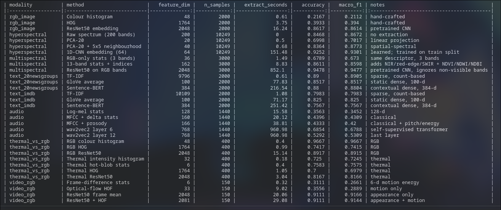

*Figure 1. Every number reported below comes from this table (`results/results.csv`).*

### 2.0 The shared harness: `common.py`

Before any feature, the comparison itself needed designing. If each script evaluated its features with a different classifier or a different split, the tables in Section 3 would mean nothing. So everything funnels through one module.

**The protocol.** Each script turns raw data into a feature matrix X of shape (n_samples, n_features). `make_split` produces one 70/30 train/test split per dataset, using a fixed seed of 42. By default the split is stratified, so class proportions survive. When a `groups` array is supplied (I use it for speech, where the groups are speakers) it switches to `GroupShuffleSplit`, which guarantees that no group appears on both sides. `linear_probe` then standardises X (`StandardScaler`) and fits a multinomial logistic regression with up to 3,000 iterations. It returns accuracy and macro-F1. `log_result` calls the probe and upserts one row into `results/results.csv`, keyed by modality and method name, so re-running a script overwrites its own rows instead of duplicating them.

**Why a linear probe.** A linear classifier cannot invent structure. If it separates the classes, the structure was already sitting in the features in a linearly usable form, so the score measures the *representation* and not the cleverness of the classifier. A random forest or an SVM would blur that. One caveat I kept in mind: a linear probe is harsh on tiny, low-variance feature sets and kind to wide embeddings, and some of my results (Section 4.5, MFCC plus prosody) probably reflect that.

**Sparse data.** TF-IDF matrices are sparse. Standardising with mean-centring would turn them dense and destroy that, so the probe checks `scipy.sparse.issparse(X)` and switches off mean-centring in that case. The same check decides whether `plot_embedding_2d` uses `TruncatedSVD` (works on sparse input) or `StandardScaler` plus PCA.

**Caching.** `cached_features(name, extractor)` runs an extractor once, stores the matrix and its wall-clock time in `data/cache/<name>.npz`, and loads it on later runs. It exists because a Colab runtime disconnected and erased an hour of CNN training (Section 4.3). It also keeps the *original* extraction time, so a cached rerun still reports an honest cost.

**Downloads.** `download_file(urls, dest, min_bytes, validate_zip)` was rewritten three times, each time after a real failure (Section 4). Its final form tries each URL in turn with several User-Agent strings, streams to disk in 1 MiB chunks (the EuroSAT archive is about 2 GB, too big to hold in memory), checks the finished file for size and, for archives, zip integrity, and deletes a corrupt file instead of trusting it on the next run. If every mirror fails it raises an error that tells you to download the file manually and upload it to `data/`.

**Small helpers.** `describe(name, array)` prints shape, dtype and value range, which is how I kept track of what each tensor looked like. `save_fig` writes into `results/figures/`.

### 2.1 RGB images

**Theoretical context.** A colour image is a rank-3 tensor (height, width, 3). Raw pixel values make poor features, because shifting an object by one pixel changes every coordinate of the vector. Three classic remedies appear here. A *colour histogram* counts how much of each intensity occurs and ignores where, which buys translation invariance at the price of all spatial information. *HOG* (Dalal and Triggs, 2005) computes image gradients, builds an orientation histogram in each small cell, and normalises across overlapping blocks, so it keeps edge and shape structure while tolerating small shifts and local lighting changes. A *CNN embedding* is learned: early layers behave like edge and colour detectors (much like HOG's gradients), middle layers respond to textures and parts, and the last convolutional block responds to object-level patterns. Taking the output of that block, averaged over space, gives a general-purpose vector.

**File analysis: `rgb_images.py`.**

1. `load_cifar10_subset` loads CIFAR-10 through `tf.keras.datasets` (it downloads about 170 MB on first use) and draws a class-balanced random subset of 200 images per class, 2,000 in total, then shuffles. I wanted a dataset small enough that the ResNet50 pass finishes in seconds on a GPU yet balanced enough that accuracy means something against the 10% chance level. TensorFlow is imported inside the function so the module can be imported (and tested) on a machine without it.
2. `color_histogram_features` takes each channel separately, builds a 16-bin histogram over the range 0 to 255, concatenates the three (48 dimensions) and divides by the total so each vector sums to 1. Normalising matters because images differ in size in general; here it simply keeps the scale tidy.
3. `hog_features` converts to grayscale with `rgb2gray`, upsamples from 32×32 to 64×64 with anti-aliasing, and calls scikit-image's `hog` with 9 orientations, 8×8-pixel cells, 2×2-cell blocks and `L2-Hys` block normalisation. The count works out as 7×7 block positions × (2×2 cells × 9 bins) = 1,764 dimensions. The upsampling is a compromise. An 8×8 cell on a 32×32 image would leave only a 4×4 grid of cells, too coarse to say anything about shape. An optional visualisation branch (`visualize=True`) produced Figure 2.
4. `cnn_embeddings` builds `ResNet50(weights="imagenet", include_top=False, pooling="avg")`, which drops the 1000-way classifier and returns a 2,048-dimensional vector per image after global average pooling over the 7×7 final feature map. Images are resized to 224×224, passed through `resnet50.preprocess_input` (the ImageNet channel-mean subtraction the weights were trained with, plus the RGB-to-BGR reordering) and processed in batches of 64 with `training=False`, so batch-norm layers use their stored statistics.

**Rationale.** scikit-image supplied HOG, `rgb2gray` and `resize` because its implementation follows the textbook description closely, which suited a report whose job is explanation. TensorFlow/Keras supplied ResNet50 because Keras ships the pretrained weights directly. The three methods sit at three points on a ladder: global colour, local shape, learned semantics. The point was to see how far each rung climbs on identical data.

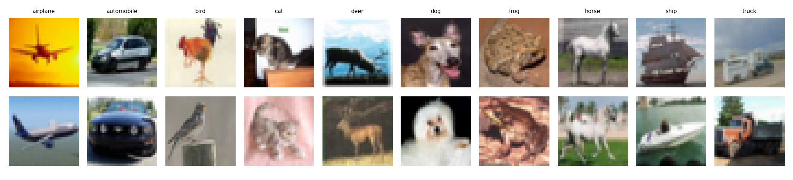

*Figure 2a. The CIFAR-10 subset: two images per class at native 32×32 resolution.*

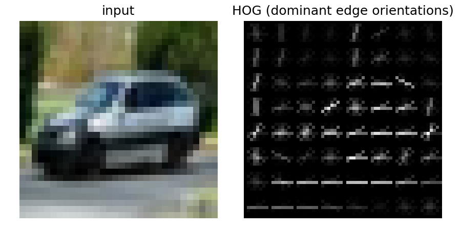

*Figure 2b. A car and its HOG descriptor. The bright strokes mark dominant gradient orientation in each 8×8 cell. The horizontal strokes along the bottom are the road edge, and the diagonals follow the car's roofline.*

**What the results show.** Colour histogram 0.217, HOG 0.393, ResNet50 0.862 against a 10% chance level. The PCA plots tell the same story visually: colour (Figure 2c) and HOG (Figure 2d) are tangled, while ResNet50 (Figure 2e) pulls vehicles to one side and animals to the other, with cats and dogs overlapping, which is exactly where a human would expect confusion.

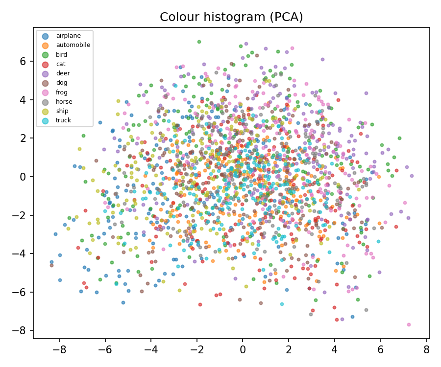

*Figure 2c. Colour histogram, first two principal components.*

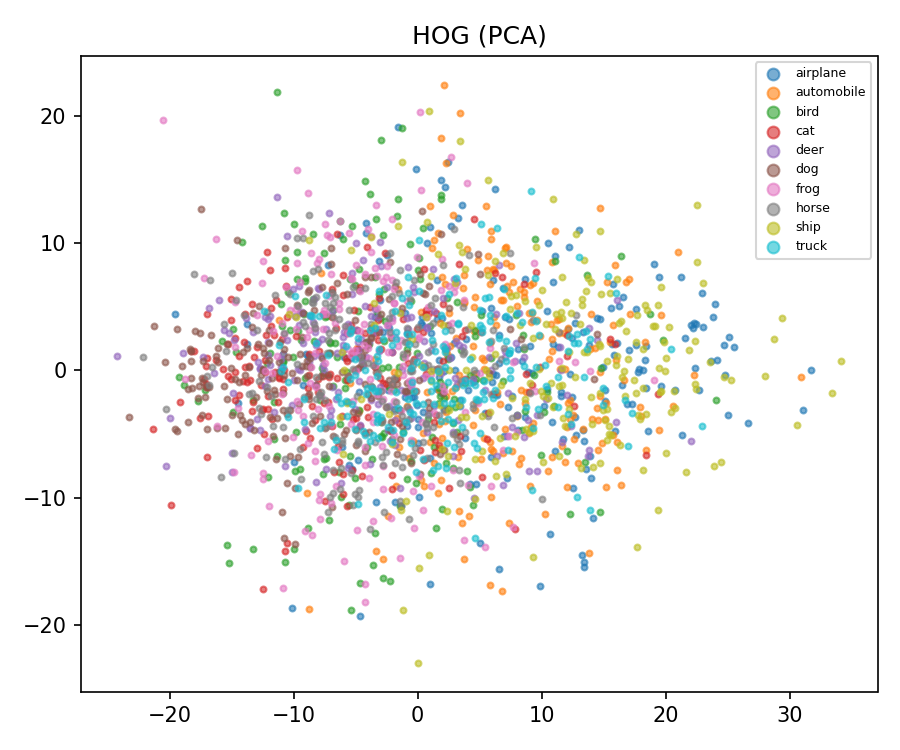

*Figure 2d. HOG, first two principal components.*

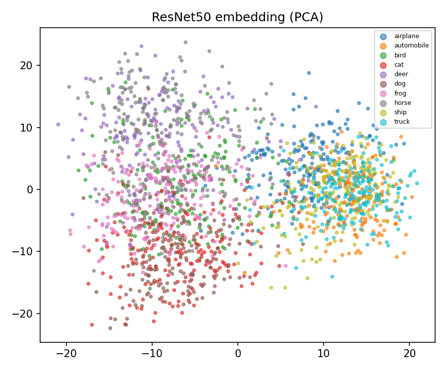

*Figure 2e. ResNet50 embedding, first two principal components. Vehicles (right) separate from animals (left).*

Two honest qualifications. CIFAR-10 images are tiny, and upscaling them to 224 pixels gives the network blurry input it was not trained on, so 0.862 is probably below what the same network would reach on native high-resolution images. And ResNet50 saw 1.2 million ImageNet images before it ever met my data; part of its lead is borrowed training data, not architecture alone.

### 2.2 Hyperspectral images

**Theoretical context.** A hyperspectral image is a data cube of shape (H, W, B). My dataset, Indian Pines, has 145×145 pixels and 200 usable bands from NASA's AVIRIS sensor. Every pixel is a *spectrum*, reflectance sampled at roughly 10 nm spacing from the visible into the short-wave infrared. Different materials absorb and reflect differently at different wavelengths (chlorophyll absorbs red light, water absorbs at specific infrared bands), so the spectrum works as a material fingerprint. Two numerical facts shape every method. Adjacent bands are almost perfectly correlated, so 200 dimensions carry far fewer than 200 independent pieces of information. And labelled pixels are scarce relative to the number of bands, which invites overfitting (the Hughes phenomenon). The standard responses are dimensionality reduction (PCA), spatial context (neighbouring pixels usually belong to the same field), and learned spectral features.

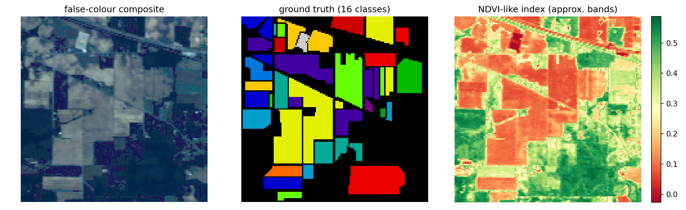

*Figure 3a. Left: a false-colour composite of three bands. Middle: the 16-class ground truth. Right: an NDVI-like index. As far as I know, Indian Pines was flown in early summer, when corn and soybean fields had little canopy, which would explain why the large crop fields show low index values while the woods in the lower right glow green.*

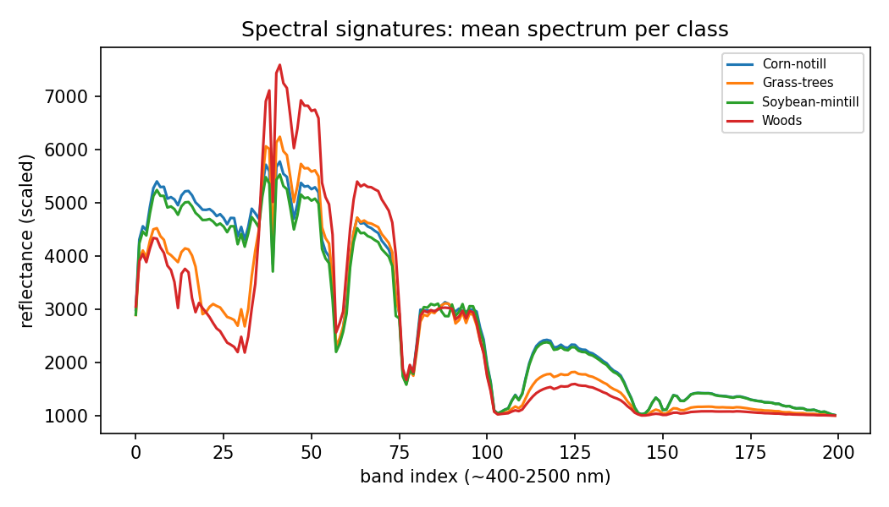

*Figure 3b. Mean spectrum per class for four classes. Woods and grass-trees (vegetation with dense canopy) separate from corn-notill and soybean-mintill in the visible bands, but corn and soybean curves lie almost on top of each other. Those two are the hard pair.*

**File analysis: `spectral_images.py`, Part A (`run_hyperspectral`).**

1. `load_indian_pines` fetches `Indian_pines_corrected.mat` (the cube) and `Indian_pines_gt.mat` (the labels) through `download_file`, then reads them with `scipy.io.loadmat` using the keys `indian_pines_corrected` and `indian_pines_gt`. The "corrected" version has the water-absorption bands already removed, leaving 200 of the original 220. The original host was unreachable, so the code points at GitHub mirrors of the identical files (Section 4.1).
2. The script keeps only labelled pixels (`gt > 0`), which gives X_spec with shape (10,249, 200) and labels 0 to 15. About half the scene is unlabelled background and carries no supervision.
3. **Raw spectrum** is the baseline: all 200 bands go straight to the probe, with no extraction cost.
4. **PCA-20** (`f_pca`) fits a 20-component PCA on the *training pixels only* and projects every pixel. It retained 98.9% of the variance. Fitting on training data alone prevents the test set leaking into the projection.
5. **Spatial-spectral features** (`f_spatial`) project the whole cube onto the same 20 components, then smooth each component image with a 5×5 neighbourhood mean (`scipy.ndimage.uniform_filter` with size `(5, 5, 1)`, so the filter runs over rows and columns but never across components). The 20 smoothed values are concatenated to each pixel's own 20 PCA values, giving 40 dimensions. My first version used only 5 components for the neighbourhood and compared unfairly against PCA-20; I changed it so the *only* difference between the two feature sets is spatial context (Section 4.5).
6. **1D-CNN** (`spectral_cnn_embeddings`) z-scores each band with statistics from the training pixels, reshapes to (N, 200, 1) and trains this network: `Conv1D(32, kernel 7)`, `MaxPool1D(2)`, `Conv1D(64, kernel 5)`, `Flatten`, `Dropout(0.3)`, `Dense(64, relu)` named `embedding`, `Dense(16, softmax)`. Adam, sparse categorical cross-entropy, 40 epochs, batch 128, 10% of the training pixels held out for validation. The 64-dimensional `embedding` layer is then read out for *all* pixels as the learned feature, and the probe runs on it. A Conv1D filter slides along the wavelength axis, which makes it a learnable absorption-feature detector: a kernel of width 7 spans about 70 nm.

**Rationale.** The decisive design choice was `Flatten` instead of global average pooling after the last convolution, and it only became clear because the first version failed (Section 4.4). Pooling over wavelength makes the network indifferent to *where* along the spectrum a pattern occurs, but an absorption dip at 1.4 µm and one at 0.7 µm mean different materials. Flattening keeps position.

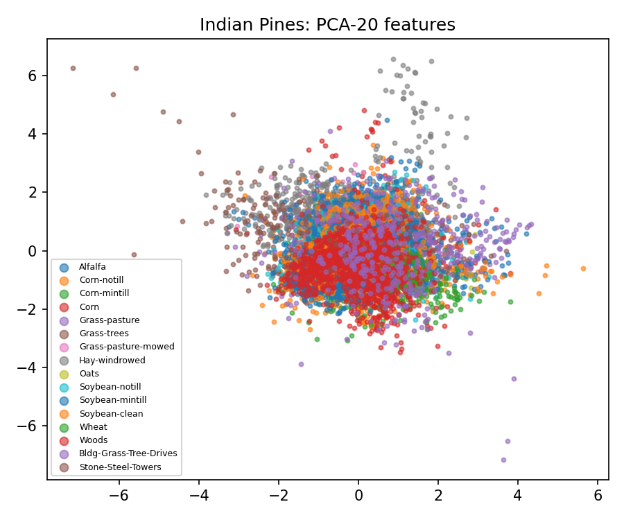

*Figure 3c. First two principal components of the PCA-20 features: a single dense blob, classes heavily overlapping.*

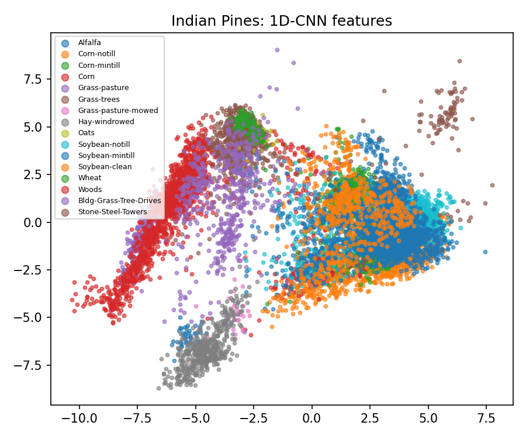

*Figure 3d. The learned 64-d embedding, same projection. Hay-windrowed, woods and the grass classes now occupy their own regions. The corn/soybean tillage classes still overlap in the centre, which matches Figure 3b.*

**Results.** Raw spectrum 0.847, PCA-20 0.700, PCA-20 plus neighbourhood 0.836, 1D-CNN 0.925 (macro-F1 0.930). The CNN's own softmax head scored 0.909 on the test split, so the embedding plus a fresh linear classifier is at least as good as the trained network's head.


### 2.3 Multispectral images

**Theoretical context.** Multispectral sensors sample fewer, wider bands than hyperspectral ones. Sentinel-2 records 13: coastal aerosol, the visible blue, green and red, four red-edge and near-infrared bands, and three short-wave-infrared bands. Fewer bands means less redundancy, but the bands are chosen for physical reasons, and remote sensing has a long tradition of combining them into *spectral indices*. NDVI = (NIR − Red) / (NIR + Red) exploits the fact that healthy leaves absorb red light and reflect near-infrared strongly. NDWI = (Green − NIR) / (Green + NIR) highlights water, which absorbs NIR. NDBI = (SWIR − NIR) / (SWIR + NIR) responds to built-up surfaces. Each index squeezes a physical relationship between bands into one number.

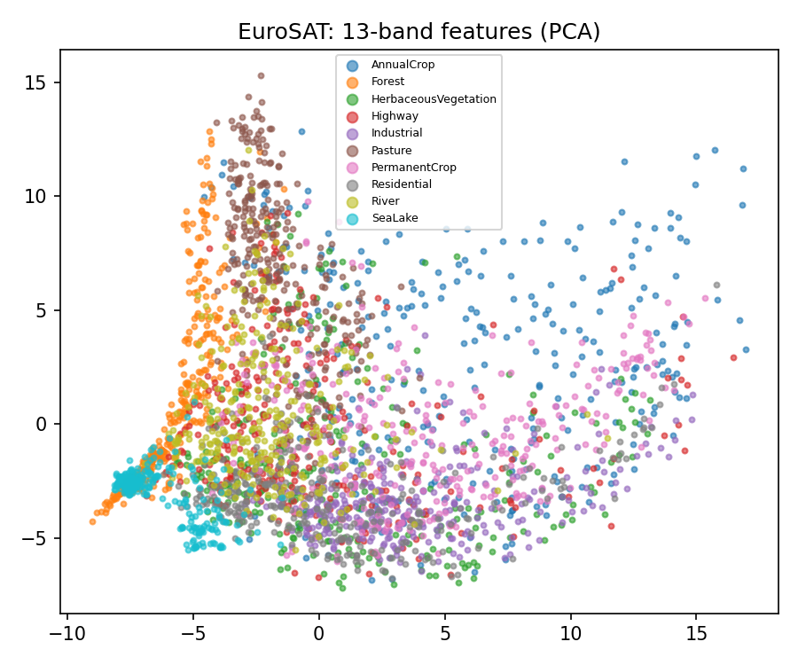

*Figure 4. First two principal components of the 13-band features. SeaLake forms a tight cluster at lower left and Forest sits to the left of it, while the crop and vegetation classes smear into one another.*

**File analysis: `spectral_images.py`, Part B (`run_multispectral`, run with the `--eurosat` flag).**

1. `load_eurosat_ms` opens the 2.1 GB archive `EuroSAT_MS.zip` directly with `zipfile`, groups the `.tif` entries by class folder, and samples 300 images per class (3,000 total) with a seeded generator. Each GeoTIFF is read with `tifffile.imread` from an in-memory buffer. If a reader returns bands first, `np.moveaxis` puts them last. The result is a `uint16` array of shape (3000, 64, 64, 13). Reading only the sampled files from the zip avoids unpacking 27,000 images to disk.
2. `band_descriptor(X, bands, lo, hi)` builds, for each chosen band, the per-image mean, standard deviation and a 10-bin histogram. The histogram range comes from the 1st and 99th percentiles of the first 500 images, per band, because Sentinel-2 reflectances span thousands of units and a fixed 0 to 255 range would be meaningless. That is 12 numbers per band: 36 for the three visible bands (indices 3, 2, 1 for red, green, blue) and 156 for all 13.
3. `spectral_indices` computes NDVI (bands B08, B04), NDWI (B03, B08) and NDBI (B11, B08) per pixel, then summarises each index map by its mean and standard deviation: six more numbers, so the full descriptor has 162 dimensions.
4. An optional third method feeds the RGB bands to the pretrained ResNet50 from `rgb_images.py`. The three bands are divided by their 99th percentile, scaled to 0 to 255 and cast to `uint8` to look like ordinary photographs. It is skipped with `--no-cnn`.

**Rationale.** The comparison I wanted was clean: the *same* descriptor on three bands versus thirteen, so any gain is attributable to the extra spectral information. Reusing `cnn_embeddings` rather than rewriting it kept the CNN arm identical to the RGB experiment.

**Results.** RGB-only statistics 0.679, 13-band statistics plus indices 0.861, ResNet50 on RGB 0.948. The extra bands are worth about 18 points. Even so, a pretrained CNN looking only at visible light wins, because my spectral descriptors are *global* per-image statistics: they know how much vegetation-like signal a patch contains but not whether it is arranged as a rectangular field or a winding river. The fair next experiment would be a CNN over all 13 channels, which I did not run. The ResNet extraction took 852 seconds, wildly slower per image than the RGB experiment's 16 seconds, which suggests that session had no GPU attached.

### 2.4 Thermal images

**Theoretical context.** A thermal camera measures emitted long-wave infrared radiation (about 8 to 14 µm), which tracks surface temperature rather than reflected light. Consequences: it works in total darkness, warm bodies such as pedestrians and engines stand out, and the images carry little texture and no colour. So the useful descriptors differ. The *intensity histogram* approximates the temperature distribution of a scene. *Segmenting hot regions* (here with Otsu's method, which picks the threshold that best separates the two modes of the histogram, warm foreground and cooler background) turns a thermal image into a few shape statistics. HOG still applies to silhouettes, and a CNN pretrained on RGB can be applied by replicating the single channel three times, though its filters were tuned to colour textures.

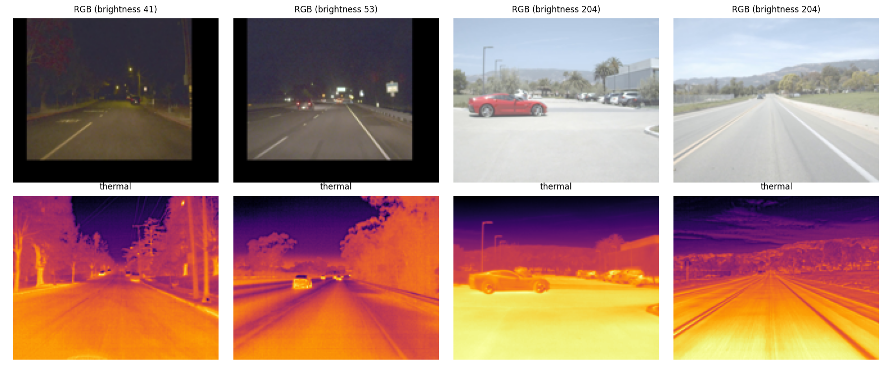

*Figure 5a. Aligned RGB/thermal pairs, two darkest and two brightest scenes by mean RGB brightness. The thermal images stay readable at night. The dark RGB frames also carry black borders, which I come back to below.*

**File analysis: `thermal_features.py`.**

1. `load_flir_paired` loads the test split of the Hugging Face dataset `newguyme/flir_paired` (a parquet file of about 187 MB) through the `datasets` library. It inspects the dataset schema, finds the image-typed columns, and guesses which is thermal and which is RGB from the column names, printing the columns and stopping with an explicit message if the guess fails. It then shuffles with seed 42 and keeps 400 pairs. `_to_arrays` resizes everything to 160×128 so arrays stack, converting RGB frames with `.convert("RGB")` and thermal frames with `.convert("L")` (single-channel). A second loader, `load_from_folders`, accepts any two folders of paired images, so the script can run on a dataset I downloaded myself.
2. **A label had to be invented**, because the paired frames come without scene classes. I defined each scene as *dark* or *bright* by splitting at the median of the mean RGB pixel value (a balanced two-class problem, chance 50%). The experiment then asks which feature families can recover that lighting label.
3. The RGB side reuses `color_histogram_features`, `hog_features` and `cnn_embeddings` from `rgb_images.py`.
4. The thermal side has four feature sets: `thermal_intensity_hist` (32 bins, normalised), `hot_blob_features` (Otsu threshold per image, then hot-pixel fraction, number of connected blobs from `skimage.measure.label`, area of the largest blob, mean and standard deviation of the hot pixels' intensity, and the threshold itself: six numbers), thermal HOG, and thermal ResNet50, both via `to3`, which repeats the single channel to three.

**Rationale and a flawed design.** I expected thermal features to sit near 50%, since temperature should not care about sunlight. They did not: 0.725 (histogram), 0.758 (hot blobs), 0.700 (HOG), 0.817 (ResNet50). I should not read that as thermal depending on light. The experiment is confounded in at least three ways. First, day and night frames come from different drives, places and ambient temperatures, so thermal statistics correlate with time of day for reasons unrelated to illumination. Second, thermal cameras apply automatic gain, rescaling intensities per frame. Third, and visible in Figure 5a, the dark RGB frames have black borders. Those borders drag the mean brightness down, so the label partly encodes the *framing* of the picture, and the RGB colour histogram (0.967) can read the border directly from its darkest bin. That number measures leakage, not feature quality. What the data do support is narrower: every RGB feature family carries at least as much lighting information as its thermal counterpart (ResNet50 0.892 against 0.817, HOG 0.742 against 0.700). With only 120 test pairs each score carries roughly ±4 points of sampling noise.

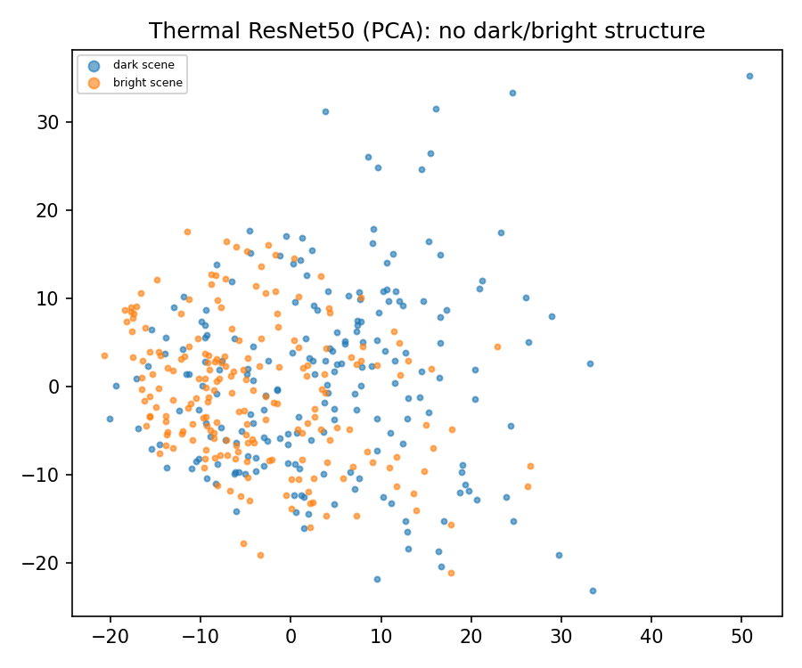

*Figure 5b. Thermal ResNet50 features in two principal components. The figure title, "no dark/bright structure", was my hypothesis hard-coded into the plotting call before I had results, and it should not be taken as a finding: the probe separates the classes at 0.817 using all 2,048 dimensions, and two components can easily hide that.*

### 2.5 RGB video

**Theoretical context.** A video clip is a rank-4 tensor (T, H, W, C), and a batch of clips is rank 5. Two kinds of information live in it: *appearance* (what is in the frames) and *motion* (how it changes). Cheap motion cues come from frame differencing, the average absolute change between consecutive frames. Richer ones come from *optical flow*, a per-pixel displacement field (dx, dy) estimated under the assumption that a point keeps its brightness as it moves. Converting the flow to magnitude and angle and histogramming the angles, weighted by magnitude, gives a *histogram of optical flow* (HOF), the motion analogue of HOG. For appearance, the simplest strong baseline is to embed every frame with an image CNN and average over time, at the cost of throwing frame order away. Heavier models (3D CNNs, video transformers) were beyond the scope.

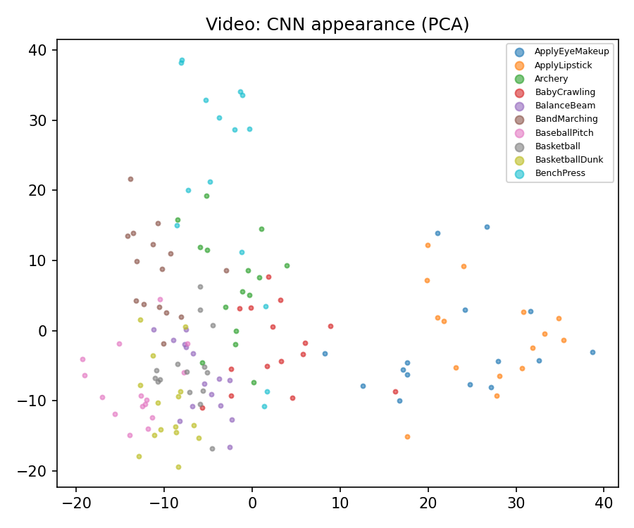

*Figure 6. Frame-averaged ResNet50 features of the 150 clips in two principal components. ApplyEyeMakeup and ApplyLipstick (right) separate cleanly. The sports clips in the gym-like classes (Basketball, BasketballDunk, BalanceBeam, BaseballPitch) pile on top of one another in this projection.*

**File analysis: `video_features.py`.**

1. `download_ucf101_subset` pulls `UCF101_subset.tar.gz` from the Hugging Face dataset `sayakpaul/ucf101-subset` with `huggingface_hub`, a 10-class cut of UCF101 that the library's own video tutorial uses, and extracts it. The full UCF101 is several gigabytes, far more than an assignment needs.
2. `pick_videos` takes the class from each file's parent folder and draws 15 clips per class with a seeded generator: 150 clips, 10 classes, chance 10%.
3. `read_frames` opens a clip with OpenCV's `cv2.VideoCapture`, reads the frame count, picks 16 evenly spaced indices (`np.linspace`), decodes sequentially, and converts each kept frame from BGR to RGB, since OpenCV's default order is the reverse of what Keras expects. A clip shorter than 16 frames repeats its last frame.
4. `frame_diff_features` resizes frames to 112×112 grayscale, computes the mean absolute difference for each consecutive pair, and summarises the 15 values with mean, standard deviation, maximum and the three quartiles: 6 dimensions.
5. `hof_features` runs Farnebäck's dense optical flow (`cv2.calcOpticalFlowFarneback` with pyramid scale 0.5, 3 levels, window 15, 3 iterations, polynomial neighbourhood 5, sigma 1.2) on the same 112×112 frames. `cv2.cartToPolar` turns each flow field into magnitude and angle. The angle goes into one of 8 orientation bins, each pixel voting with its magnitude, separately inside each cell of a 2×2 spatial grid. The histograms are averaged over the 15 flow fields and the mean flow magnitude is appended: 2×2×8 + 1 = 33 dimensions.
6. `cnn_video_features` stacks all frames of all clips into one (N·T, H, W, 3) array, runs `cnn_embeddings` once, reshapes to (N, T, 2048) and averages over T. Doing a single big call rather than one call per clip lets the batching in `cnn_embeddings` do its job.
7. A fourth method concatenates the CNN vector and the HOF vector (2,081 dimensions).

**Rationale.** OpenCV is the natural tool here because video decoding, Farnebäck flow and (below) background subtraction are all fast C++ implementations behind a Python interface, and a pure-Python flow solver would have taken hours. 112×112 was a speed compromise for flow; the CNN path upsamples to 224 on its own. Sixteen frames per clip is the usual choice in action-recognition work for a short clip.

**Results.** Frame difference 0.311, HOF 0.356, ResNet50 frame mean 0.911, ResNet50 plus HOF 0.911. Appearance dominates, and my motion features added nothing on top of it. The test set is 45 clips (about ±4.5 points), so small differences mean little. I think two things are going on. UCF101 classes are often recognisable from one frame (a pool, an archery range), a known property of the benchmark. And my HOF is crude, with a coarse 2×2 grid and no compensation for camera motion.

### 2.6 Thermal video

**Theoretical context.** In thermal video the warm moving object (a pedestrian, a car) is usually far brighter than a cooler, mostly static background, so motion segmentation becomes far easier than in RGB. A *Gaussian mixture background model* (MOG2) keeps, per pixel, a mixture of Gaussians describing its recent values; a pixel that fits poorly is flagged as foreground.

**File analysis: `video_features.py`, function `thermal_motion_demo` (run with `--thermal-dir <folder>`).** It reads up to 200 sequential frames as grayscale, builds `cv2.createBackgroundSubtractorMOG2(history=50, varThreshold=25, detectShadows=False)` (shadows are irrelevant in thermal), applies each frame, cleans the mask with a 3×3 morphological opening to remove speckle, counts foreground blobs with `cv2.connectedComponents`, and reports mean foreground fraction and mean blobs per frame. It also saves a figure of three frames with their masks.

**Status, stated plainly.** I did not run this on real thermal video. I tested it on synthetic frames with a moving warm square (it reported about one blob per frame, as it should), but I could not obtain a suitable small thermal-video dataset in time. FLIR ADAS video sequences, KAIST and LLVIP are the obvious candidates. The thermal evidence in this report therefore comes from still thermal images (Section 2.4), and Section 3 marks this row as not evaluated.


### 2.7 Audio (human speech)

**Theoretical context.** A raw waveform is a long vector of amplitudes: at 16 kHz, one second is 16,000 numbers, and what a listener hears (which vowel, which emotion) is not readable from them directly. The information sits in *how the frequency content changes over time*. The standard pipeline builds that view in four moves. The short-time Fourier transform (STFT) slides a short window (25 ms, because speech is roughly stationary over that span) along the signal and takes an FFT in each, giving a time-frequency picture. A mel filterbank then pools the linear frequency axis with triangular filters that are narrow at low frequencies and wide at high ones, mimicking human hearing (mel = 2595·log10(1 + f/700)). A logarithm follows, since perceived loudness is roughly logarithmic in power. Finally, a discrete cosine transform decorrelates the log-mel energies and separates the smooth spectral envelope, shaped by the vocal tract and telling us *which sound* is being made, from the fast ripple caused by the pitch of the vocal folds. Keep the low coefficients and you have MFCCs. Prosody (pitch, energy, zero-crossing rate) is not in the envelope at all, yet it carries a lot of emotion. The modern alternative is **wav2vec 2.0**, a transformer pretrained *without labels* on 960 hours of speech: a convolutional encoder turns the raw waveform into latent frames every 20 ms, and the transformer is trained to identify the true latent for masked frames among distractors. Its hidden states end up encoding phonetic, speaker and emotional information.

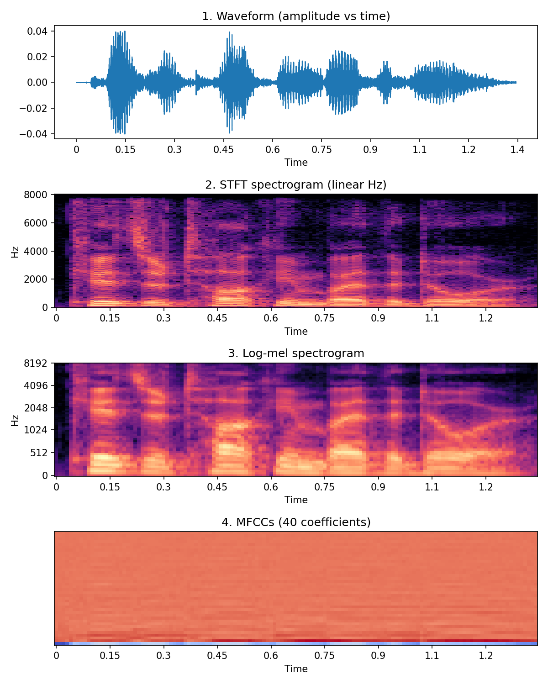

*Figure 7a. One RAVDESS clip, four stages: waveform, STFT spectrogram, log-mel spectrogram, MFCCs. The harmonic stripes of voiced speech are clear in the first spectrogram and get compressed at high frequencies in the mel version. The MFCC panel looks almost flat because coefficient 0 (overall log-energy) is far larger than all the others and sets the colour scale; the probe's standardisation step removes that imbalance before classification.*

**File analysis: `audio_features.py`.**

1. `download_ravdess` fetches `Audio_Speech_Actors_01-24.zip` (about 215 MB; 1,440 speech clips from 24 actors) from Zenodo, validated and extracted. `parse_labels` reads the label out of each filename. RAVDESS encodes everything in seven dash-separated numbers; field 3 is the emotion (1 neutral, 2 calm, 3 happy, 4 sad, 5 angry, 6 fearful, 7 disgust, 8 surprised) and field 7 is the actor ID.
2. `load_wave` uses `librosa.load` to read, resample to 16 kHz and mix down to mono, then `librosa.effects.trim` with a 25 dB threshold to strip leading and trailing silence, which would otherwise dilute the averaged statistics.
3. Shared constants: 25 ms window (`n_fft=400`), 10 ms hop (`hop_length=160`), 64 mel bands.
4. `log_mel` computes the mel spectrogram and converts power to decibels relative to the clip maximum. `stats` then reduces any (features × frames) matrix to a fixed vector by concatenating the mean and standard deviation across time, necessary because clips differ in length. Log-mel statistics: 128 dimensions.
5. `mfcc` takes 40 coefficients from the same STFT settings. `feat_mfcc` adds the *delta* (local slope over time) of each coefficient, a cheap description of dynamics, and applies `stats` to both: 160 dimensions.
6. `prosody` computes the fundamental frequency with `librosa.yin` (search range 65 to 500 Hz), RMS energy and zero-crossing rate, and keeps mean and standard deviation of each: six numbers. `feat_mfcc_prosody` appends them to the MFCC vector: 166 dimensions.
7. `feat_wav2vec` loads `facebook/wav2vec2-base` and its feature extractor (which normalises each waveform to zero mean and unit variance, as the model expects), moves the model to the GPU if one exists, runs each clip with `output_hidden_states=True`, and mean-pools over time the hidden states of layer 6 and layer 12 (768 dimensions each). One forward pass yields both, which is why both rows share one extraction time.
8. `main` builds the split with `groups=actors`, so test actors never appear in training. This was a deliberate decision about leakage: with a random split a classifier can identify the *speaker*, whose voice is constant across their clips, and score well without learning anything about emotion.

**Rationale for the tools.** librosa is the standard library for audio analysis in Python: its STFT, mel filterbank, DCT and YIN implementations are well tested and follow the textbook definitions, so my explanation above matches what the code does. OpenCV, scikit-image and NLTK have nothing comparable for signals. wav2vec 2.0 came through Hugging Face Transformers, which hosts the pretrained weights. These models ran on the PyTorch backend that Colab already provides, while the image models and the 1D-CNN use TensorFlow/Keras. I ended up using both frameworks in one project, which would not be my first choice, but each library's best-supported path was the pragmatic one.

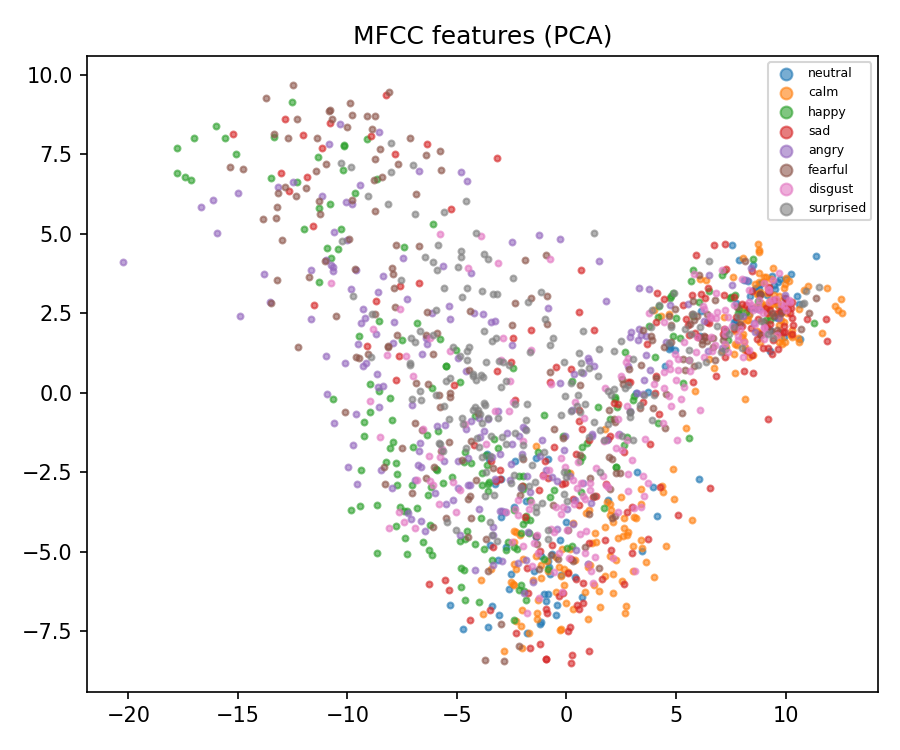

*Figure 7b. MFCC features in two principal components. Low-arousal emotions (neutral, calm) are packed into a tight region on the right, while high-arousal ones (angry, happy, fearful, surprised) spread out, a rough sign that MFCCs capture energy and spectral brightness better than they separate individual emotions.*

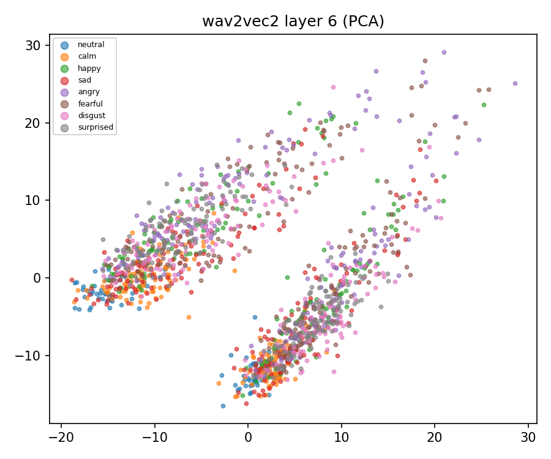

*Figure 7c. wav2vec2 layer 6, two principal components. Two big lobes dominate the plot, with every emotion inside each of them. I suspect the split reflects speaker characteristics such as male versus female voices, since the model encodes speaker information prominently, but I did not check this.*

**Results.** Chance is 12.5% for eight classes. Log-mel statistics 0.356, MFCC plus delta 0.440, MFCC plus prosody 0.433, wav2vec2 layer 6 **0.685**, wav2vec2 layer 12 0.529. Two surprises. The middle layer beats the last by about 16 points: the final layers of a self-supervised transformer specialise towards the pretraining objective of predicting masked units, while middle layers keep more speaker and paralinguistic information, which emotion needs. And adding prosody to MFCCs did not help. Six extra numbers among 166 may be too few for a linear probe to exploit, though I did not test that. Time is the price: classical features took 16 to 39 seconds for 1,440 clips on CPU, wav2vec2 about 961, roughly 50 times more.

### 2.8 Text

**Theoretical context.** Text is a sequence of discrete symbols, so the first job is turning words into numbers. Three generations are represented here. *TF-IDF* scores each word by its frequency in a document times the logarithm of how rare it is across the corpus, so frequent-but-ubiquitous words such as "the" fall to near zero and distinctive words dominate. The vectors are sparse (here about 10,000 dimensions), interpretable and ignorant of meaning: "good" and "great" are unrelated columns. *Static word embeddings* such as GloVe learn dense vectors from co-occurrence statistics, so that similar words sit close together; a document vector is the mean of its word vectors, which loses word order and gives each word type exactly one vector. *Contextual transformer embeddings* (BERT and its descendants, here Sentence-BERT) let self-attention mix information across the sentence, so the same word receives different vectors in different contexts.

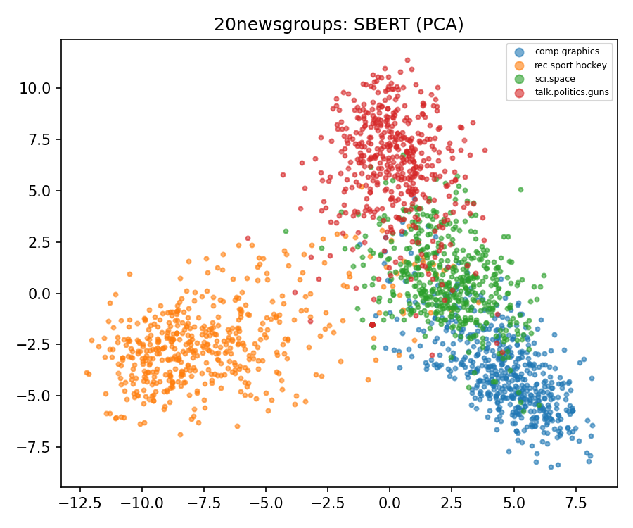

*Figure 8a. Sentence-BERT embeddings of 20 Newsgroups documents. Hockey (orange) separates well, politics-guns (red) forms its own group, and graphics (blue) and space (green) overlap partly.*

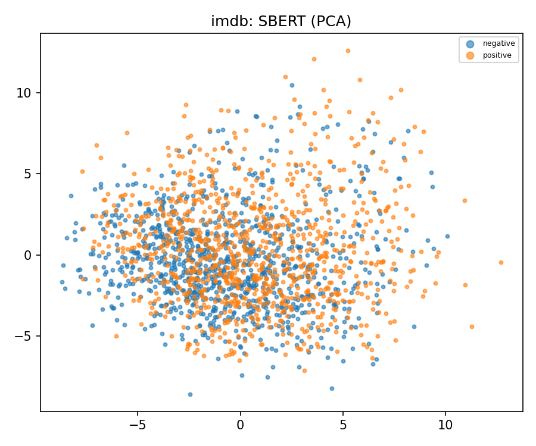

*Figure 8b. The same embedding on IMDB reviews, coloured by sentiment. Negative and positive reviews are thoroughly mixed in two components, which fits the weak result below.*

**File analysis: `text_features.py`.**

1. `load_newsgroups` uses scikit-learn's `fetch_20newsgroups` for four topics (space, hockey, guns politics, graphics) with headers, footers and quoted replies removed, since those lines leak the newsgroup name and would let a model cheat. It keeps 2,000 documents. `load_imdb` takes 2,000 shuffled training reviews from the Hugging Face `stanfordnlp/imdb` dataset.
2. `tfidf_by_hand_demo` is a teaching function. On a three-document toy corpus it computes counts, document frequencies, the smoothed inverse document frequency ln((1+N)/(1+df)) + 1 and the L2-normalised product by hand, and compares the result with `TfidfVectorizer` using `np.allclose`.
3. `contextual_vs_static_demo` loads `bert-base-uncased`, takes the hidden vector for the word "bank" from three sentences (river bank, cash deposit, bank loan) and prints pairwise cosine similarities. A static embedding would return exactly 1.000 for every pair; BERT's differ, and the two financial uses should be closest.
4. `tfidf_features` fits `TfidfVectorizer(stop_words="english", sublinear_tf=True, min_df=2, max_features=20000)` on the *training* documents only and transforms all. `sublinear_tf` replaces the count with 1 + log(count) so one word repeated fifty times does not swamp the vector, and `min_df=2` drops words seen in a single document. The result is about 9,800 (newsgroups) or 10,100 (IMDB) dimensions.
5. `glove_average_features` downloads `glove-wiki-gigaword-100` through gensim (about 128 MB, 400,000 words), tokenises with NLTK's `RegexpTokenizer(r"[a-z']+")` after lowercasing, averages the vectors of in-vocabulary words and leaves a zero vector if none match. I chose the regex tokenizer over `word_tokenize` because the latter needs an extra data download that was one more thing to fail.
6. `sbert_features` encodes with `all-MiniLM-L6-v2` in batches of 64, producing 384 dimensions per document. The model truncates input to 256 tokens, so long IMDB reviews lose their endings.
7. `run_experiment` is called once per dataset, so both tasks go through identical code.

**Rationale.** Two tasks, deliberately. Topic classification should favour TF-IDF, since topics announce themselves through keywords. Sentiment should need meaning and negation, which is where I expected the transformer to shine.

**Results.** On 20 Newsgroups, TF-IDF 0.890, Sentence-BERT 0.880, GloVe 0.852. The first two are within noise (±1.4 points). On IMDB the order flipped in a way I did not predict: GloVe average **0.825**, TF-IDF 0.798, Sentence-BERT 0.757. My working explanation, untested: `all-MiniLM-L6-v2` was trained to place *semantically similar* sentences close together, which emphasises topic ("a film about a prison") over polarity, and it truncates long reviews exactly where the verdict often sits. Averaged GloVe vectors keep strongly polarised words such as "awful". A sentiment-fine-tuned model would very probably reverse the ranking. The lesson I take is that an embedding is good *for what it was trained to do*, and that "transformer" is not a synonym for "better".


---

## 3. Feature Comparisons

How to read these tables. *Acc* and *F1* (macro) are linear-probe scores on the held-out 30%. *Time* is extraction time in seconds on Colab; for learned methods it includes model inference, or training in the 1D-CNN's case. Colab sessions had different hardware, so compare times *within* a table, never across them. The complexity and semantic-depth columns are my qualitative judgement, informed by the measurements.

A word on noise. The standard error of an accuracy *p* on *n* test items is about √(p(1−p)/n). That is roughly ±0.5 points for Indian Pines, ±1.4 for the text sets, ±2.4 for audio, ±4 for the thermal pairs and ±4.5 for video. Gaps smaller than that should be treated as ties.

### 3.1 RGB images (CIFAR-10, 2,000 images, chance 10%)

| Method | Dim | Acc | Macro-F1 | Time (s) | Computational complexity | Semantic depth | Ideal use case |
|---|---|---|---|---|---|---|---|
| Colour histogram | 48 | 0.217 | 0.211 | 0.6 | Linear in pixel count | Very low: global colour only, no layout | Scene-colour cues, quick retrieval baselines |
| HOG | 1764 | 0.393 | 0.394 | 3.8 | Linear in pixels, larger constant (gradients, block normalisation) | Low: local edges and shape | Small datasets, no training data or GPU, interpretable detectors |
| ResNet50 embedding | 2048 | 0.862 | 0.861 | 16.2 | About 4 billion multiply-adds per image, 25.6M parameters | High: object-level semantics | Transfer learning, general-purpose image features |

### 3.2 Hyperspectral images (Indian Pines, 10,249 pixels, 16 classes)

| Method | Dim | Acc | Macro-F1 | Time (s) | Computational complexity | Semantic depth | Ideal use case |
|---|---|---|---|---|---|---|---|
| Raw spectrum | 200 | 0.847 | 0.867 | 0 | None | Physical fingerprint, no abstraction | Strong baseline; spectral-library matching |
| PCA-20 | 20 | 0.700 | 0.702 | 0.5 | O(N·B·k) projection | Linear compression, keeps variance not class information | Visualisation, denoising, speed |
| PCA-20 + 5×5 neighbourhood | 40 | 0.836 | 0.877 | 0.7 | PCA plus a spatial filter | Adds spatial context | Large homogeneous regions (fields, forest) |
| 1D-CNN embedding | 64 | 0.925 | 0.930 | 151 (includes training) | Conv layers plus a training loop | Learned spectral patterns, position-aware | Enough labelled pixels; best accuracy |

### 3.3 Multispectral images (EuroSAT-MS, 3,000 patches, chance 10%)

| Method | Dim | Acc | Macro-F1 | Time (s) | Computational complexity | Semantic depth | Ideal use case |
|---|---|---|---|---|---|---|---|
| RGB-only band statistics | 36 | 0.679 | 0.673 | 1.5 | Linear in pixels × bands | Low | Baseline using visible light only |
| 13-band statistics + indices | 162 | 0.861 | 0.860 | 8.8 | Linear in pixels × bands | Medium: physical indices (vegetation, water, built-up) | Interpretable, cheap, no GPU |
| ResNet50 on RGB bands | 2048 | 0.948 | 0.948 | 852 (probably no GPU) | About 4 billion multiply-adds per image | High: spatial semantics | Best accuracy when spatial layout matters |

### 3.4 Thermal images, paired with RGB (400 pairs, dark/bright scene label, chance 50%)

| Method | Dim | Acc | Macro-F1 | Time (s) | Computational complexity | Semantic depth | Ideal use case |
|---|---|---|---|---|---|---|---|
| RGB colour histogram | 48 | 0.967 | 0.967 | 0.4 | Linear in pixels | Reads brightness directly (label leakage) | Not informative here |
| RGB HOG | 1764 | 0.742 | 0.742 | 1.0 | Linear in pixels | Edge structure | Shape cues in daylight |
| RGB ResNet50 | 2048 | 0.892 | 0.892 | 15.1 | About 4 billion multiply-adds per image | High | Daylight object recognition |
| Thermal intensity histogram | 32 | 0.725 | 0.725 | 0.2 | Linear in pixels | Temperature distribution | Quick scene-level thermal descriptor |
| Thermal hot-blob statistics | 6 | 0.758 | 0.758 | 0.4 | Threshold plus connected components | Warm-object structure | Pedestrian or vehicle presence, tiny models |
| Thermal HOG | 1764 | 0.700 | 0.698 | 1.1 | Linear in pixels | Silhouette edges | Shape from thermal contrast |
| Thermal ResNet50 | 2048 | 0.817 | 0.817 | 3.0 | About 4 billion multiply-adds per image | High, though filters were tuned on RGB | Thermal recognition when no thermal-trained model is available |

The scores here answer "how much lighting information does this feature carry", not "how good is this feature", and the label is confounded (Section 2.4).

### 3.5 RGB video (UCF101 subset, 150 clips, chance 10%)

| Method | Dim | Acc | Macro-F1 | Time (s) | Computational complexity | Semantic depth | Ideal use case |
|---|---|---|---|---|---|---|---|
| Frame-difference statistics | 6 | 0.311 | 0.266 | 0.3 | Linear in frames × pixels | Very low: overall motion energy | Motion detection, activity gating |
| Optical-flow HOF | 33 | 0.356 | 0.289 | 9.0 | Iterative flow solver per frame pair | Low to medium: direction and speed of motion | Action cues independent of appearance |
| ResNet50 frame mean | 2048 | 0.911 | 0.917 | 20.1 | 16 CNN passes per clip | High: objects and scenes, no temporal order | Appearance-driven classes |
| ResNet50 + HOF | 2081 | 0.911 | 0.914 | 29.1 (sum) | Both of the above | High plus motion | Classes that share scenes but differ in action |

### 3.6 Thermal video

| Method | Dim | Acc | Time | Computational complexity | Semantic depth | Ideal use case |
|---|---|---|---|---|---|---|
| MOG2 background subtraction + blob counts | few | not evaluated | not measured | Per-pixel mixture update, linear in pixels per frame | Low: moving warm regions only | Surveillance, pedestrian detection at night, no training needed |

### 3.7 Speech audio (RAVDESS, 1,440 clips, 8 emotions, speaker-independent split, chance 12.5%)

| Method | Dim | Acc | Macro-F1 | Time (s) | Computational complexity | Semantic depth | Ideal use case |
|---|---|---|---|---|---|---|---|
| Log-mel statistics | 128 | 0.356 | 0.345 | 15.6 | FFT, O(T log N) per frame | Low: coarse spectral shape | Spectral-shape baseline |
| MFCC + delta statistics | 160 | 0.440 | 0.431 | 20.1 | FFT, filterbank, DCT | Medium: spectral envelope plus dynamics | Classical ASR, speaker and emotion features on CPU |
| MFCC + prosody | 166 | 0.433 | 0.420 | 38.8 | Adds pitch tracking (YIN) | Medium: envelope plus pitch and energy | Emotion cues when compute is tight |
| wav2vec2, layer 6 | 768 | 0.685 | 0.679 | 961 (shared) | About 95M-parameter transformer | High: phonetic, speaker, emotional | Best accuracy for emotion and speaker tasks |
| wav2vec2, layer 12 | 768 | 0.529 | 0.531 | 961 (shared) | Same forward pass | High but specialised to the pretraining task | Less suited to emotion |

### 3.8 Text (2,000 documents per dataset)

| Dataset | Method | Dim | Acc | Macro-F1 | Time (s) | Computational complexity | Semantic depth | Ideal use case |
|---|---|---|---|---|---|---|---|---|
| 20 Newsgroups (chance 25%) | TF-IDF | 9,796 | 0.890 | 0.891 | 0.6 | Linear in token count | Lexical only | Topic classification, search, strong cheap baseline |
| 20 Newsgroups | GloVe average | 100 | 0.852 | 0.852 | 77.8 | Linear in tokens, plus loading a 128 MB table | Static word meaning, no order | Small dense features, fuzzy topic similarity |
| 20 Newsgroups | Sentence-BERT | 384 | 0.880 | 0.880 | 216.5 | 22M-parameter transformer | Contextual | Semantic search, paraphrase matching |
| IMDB (chance 50%) | TF-IDF | 10,109 | 0.798 | 0.798 | 1.1 | Linear in token count | Lexical only | Quick sentiment baseline |
| IMDB | GloVe average | 100 | 0.825 | 0.825 | 71.2 | Linear in tokens | Static word meaning | Sentiment with polarised vocabulary |
| IMDB | Sentence-BERT | 384 | 0.757 | 0.757 | 251.4 | 22M-parameter transformer | Contextual, tuned for similarity rather than polarity | Semantic similarity, not sentiment |

### 3.9 Across modalities

| Modality | Best traditional (acc) | Best learned (acc) | Take-away |
|---|---|---|---|
| RGB image | HOG 0.393 | ResNet50 0.862 | Learned hierarchy wins by a wide margin |
| Hyperspectral | Raw spectrum 0.847 | 1D-CNN 0.925 | Position along the spectrum matters; PCA discarded class information |
| Multispectral | 13-band statistics 0.861 | ResNet50 on RGB 0.948 | Extra bands add about 18 points, but spatial learning adds more |
| Text, topics | TF-IDF 0.890 | Sentence-BERT 0.880 | No gain when keywords suffice |
| Text, sentiment | TF-IDF 0.798 | GloVe 0.825 (Sentence-BERT 0.757) | An embedding helps only if it was trained for the task |
| Speech | MFCC 0.440 | wav2vec2 layer 6 0.685 | Self-supervised features win; the layer matters |
| RGB video | HOF 0.356 | ResNet50 0.911 | Appearance dominates on UCF101 |

The pattern: learned features usually win, but the margin ranges from enormous (images, video) to nothing (topic classification) to negative (my sentiment run), and it always comes with a cost in compute, pretrained weights and, for the larger models, a GPU.

---

## 4. Project Challenges & Hiccups

This section lists the real problems I hit, in roughly the order they appeared.

### 4.1 Indian Pines would not download (HTTP 403, then a dead host)

The first run of `spectral_images.py` stopped at `urllib.error.HTTPError: HTTP Error 403: Forbidden` while fetching `Indian_pines_corrected.mat` from the university host that serves the dataset. My first theory was that the server rejects Python's default `Python-urllib` User-Agent, which is common, so I added a browser-style User-Agent to the downloader. It turned out to be only part of the story: when I tried the dataset page in an ordinary browser, it was unreachable too. The host was simply down for me.

The fix was to find other copies. Several public GitHub repositories carry the same two files. I checked that four of them serve byte-identical data (the corrected cube is 5,953,527 bytes, the ground truth 1,125 bytes), then loaded one and confirmed the shapes: a (145, 145, 200) cube, a (145, 145) label map, 16 classes, 10,249 labelled pixels, and the variable names `indian_pines_corrected` and `indian_pines_gt`. The loader now tries the GitHub mirrors first and the original host last, and the error message explains how to upload the files by hand.

### 4.2 The Colab runtime disconnected and wiped my results

I had a complete set of hyperspectral results, the runtime disconnected, and everything in memory and on the temporary disk went with it. Rerunning cost me the 150-second CNN training again. Three changes came out of that. `cached_features` now stores every feature matrix and its extraction time under `data/cache/`. The other safeguard is copying that cache to Google Drive between sessions. And I started committing `results/` to GitHub after each script finished. Since then a disconnect costs a minute, not an hour.

### 4.3 The 1D-CNN lost to the raw spectrum

The first learned model for Indian Pines scored 0.650 accuracy (macro-F1 0.566), far below the raw 200-band spectrum at 0.847. A learned feature underperforming the raw input is a red flag, not an acceptable result. The training code had no obvious bug, so I suspected the architecture. The network ended its convolutional stack with `GlobalAveragePooling1D`, which averages each filter's response over the whole wavelength axis. That makes the representation indifferent to *where* in the spectrum a pattern appears, and for spectra position is the information.

To check the diagnosis I trained both variants on the same split with real data. Global average pooling gave 0.647; replacing it with `Flatten` plus `Dropout(0.3)` gave 0.927. In my own runs on Colab the fixed network scored 0.932 once and 0.925 another time. The difference is ordinary run-to-run variation in TensorFlow training, which a fixed seed does not fully remove.

### 4.4 An unfair comparison, and the PCA surprise

My first spatial-spectral feature set used the neighbourhood mean of only 5 principal components, so it had 10 dimensions and was compared against the 20-component PCA baseline. It scored lower, and I could not tell whether spatial context hurt or the 5-versus-20 difference did. I rebuilt it as PCA-20 plus the neighbourhood mean of the same 20 components (40 dimensions), so that spatial context is the only change. The result then made sense: 0.700 to 0.836.

The bigger conceptual hurdle was why PCA-20 (98.9% of the variance retained) scored 14 points below the raw spectrum. I had half-assumed that keeping nearly all the variance means keeping nearly all the information. It does not: variance measures spread, not class separation. The fine differences between corn and soybean classes sit in low-variance directions that PCA throws away first. I also had to remember that the spatial gain is optimistic, because with a random pixel split many test pixels have training neighbours.

### 4.5 EuroSAT: a missing module, then a dead host

Running `--eurosat` stopped inside TensorFlow Datasets with `ModuleNotFoundError: No module named 'importlib_resources'`, a dependency problem on Colab's Python 3.13. Installing `importlib_resources` got past that and exposed the real obstacle: the download from the dataset's original host (`madm.dfki.de`) printed `ConnectTimeoutError ... Retrying` over and over until I killed it. It had also left a half-built dataset folder behind (the log warned that the folder had no `dataset_info.json`), which needs deleting before a retry.

I dropped TensorFlow Datasets for this dataset altogether and rewrote `load_eurosat_ms` to read the official archive from Zenodo directly with `zipfile` and `tifffile`, sampling files straight out of the zip. That also removed a dependency.

### 4.6 Wrong Zenodo link

The first Zenodo URL I put into the loader pointed at a record number that does not host the multispectral archive, and following it in a browser gave "page not found". Searching for the dataset's actual record turned up the right one (record 7711097, `EuroSAT_MS.zip`, about 2.1 GB), and I corrected the loader. Lesson: verify a URL by opening it before building code around it.

### 4.7 `BadZipFile: File is not a zip file`

With the right URL, the next run died at `zipfile.BadZipFile: File is not a zip file`. It failed immediately after "downloading", far too fast for a 2 GB transfer, so the saved file cannot have been the dataset. Most likely the server had returned a small error or rate-limit page, which my downloader had happily saved under the `.zip` name. Worse, the next run would see that file existing and skip downloading entirely.

I rewrote `download_file` to validate its output: a minimum size (1.5 GB for EuroSAT, 150 MB for RAVDESS), `zipfile.is_zipfile` for archives, deletion of any invalid file, several User-Agent strings per URL, Zenodo's API download path as an extra mirror, and an error message that prints the first bytes of whatever was received. After that, the EuroSAT download and the full run completed.

### 4.8 Slow extractors

wav2vec2 on 1,440 clips took about 961 seconds, and ResNet50 on EuroSAT took 852 seconds, which is out of proportion to the 16 seconds the same network needed for 2,000 CIFAR images. The second figure points to a session without GPU acceleration. I did not rerun it. The practical consequence is that the timing columns are only meaningful within one modality's table.

### 4.9 Thermal data: a hard search and a confounded experiment

FLIR's own ADAS dataset, as I understood it, needs a registration step and is large, and I wanted something loadable in a few lines. Hugging Face has a paired FLIR dataset (`newguyme/flir_paired`) with a manageable test split, so the thermal script uses that, with column auto-detection because I could not see the schema in advance. I could not find a thermal-video dataset I could verify and download in time, so the thermal-video code was never run on real data.

The thermal experiment itself taught me something about experimental design. The frames have no class labels, so I invented a dark/bright label from RGB brightness and predicted that thermal features would stay near chance. They scored 0.70 to 0.82. Looking at the figure of the pairs showed black borders on the dark RGB frames, which means the label partly encodes image framing, and the RGB colour histogram's 0.967 is leakage. The plot title "no dark/bright structure" was hard-coded before I had any results, and I had to treat it as a wrong prediction rather than a finding.

### 4.10 No TPU

`tensors_tpu.py` tried to initialise a TPU, raised a `ValueError`, and fell back to the default strategy on one Tesla T4 GPU. The fallback is exactly what I wrote it to do, but it means the `TPUStrategy` path is written and reasoned about, not run on a TPU. I report that plainly in Section 5.

### 4.11 Sentence-BERT lost on sentiment

I had assumed a transformer embedding would win the sentiment task. It came last (0.757), behind both TF-IDF and averaged GloVe. I treated that as a finding rather than a bug, since the code is identical to the one that works well on newsgroups, and spent time working out why. Section 2.8 gives the likely reasons (a similarity-trained model, truncation at 256 tokens), none of which I tested directly.


---

## 5. Tensor, TPU, and TensorFlow Deep Dive

The file for this section is `tensors_tpu.py`. It has six parts, each printing what it demonstrates, and everything below that is labelled as measured came from running it on a Colab Tesla T4 GPU.

### 5.1 What a tensor is

*Mathematically*, a tensor is a multilinear map: an object with a number of indices (its rank or order) whose components transform in a prescribed way when you change the basis. A scalar has no indices, a vector one, a matrix two, and a rank-3 tensor T_ijk has three. The transformation rule is what separates a tensor from a mere table of numbers, and it is the reason physicists get excited about them. In machine learning we mostly borrow the container and ignore the rule.

*Computationally*, a tensor is an **n-dimensional array with a dtype and a shape**. Rank is the number of axes, shape lists the length of each, and the number of elements is the product of the shape. Everything else follows from that. A float32 element takes 4 bytes, so memory is four times the element count, which is why shapes matter in practice.

| Rank | Name | Example in this project |
|---|---|---|
| 0 | Scalar | A loss value |
| 1 | Vector | One MFCC frame; one TF-IDF row; a 2,048-d ResNet embedding |
| 2 | Matrix | A grayscale or thermal image; the feature matrix X |
| 3 | 3-D tensor | An RGB image (H, W, 3); the Indian Pines cube (145, 145, 200) |
| 4 | 4-D tensor | A batch of images (N, H, W, C); a EuroSAT batch (32, 64, 64, 13) |
| 5 | 5-D tensor | A batch of video clips (N, T, H, W, C) |

Part 1 of the script prints the natural shape of every modality in this assignment, with its memory footprint in float32. The figures below are exact arithmetic on the shapes:

| Data | Shape | MB (float32) |
|---|---|---|
| RGB image batch | (32, 224, 224, 3) | 19.3 |
| EuroSAT batch | (32, 64, 64, 13) | 6.8 |
| Indian Pines cube | (145, 145, 200) | 16.8 |
| Thermal batch | (32, 512, 640, 1) | 41.9 |
| RGB video batch | (8, 16, 112, 112, 3) | 19.3 |
| Log-mel spectrogram batch | (32, 64, 300, 1) | 2.5 |
| wav2vec2 hidden states | (1, 180, 768) | 0.6 |
| BERT token embeddings | (32, 128, 768) | 12.6 |

Part 2 demonstrates the operations that dominate deep learning. A matrix product of a (2×3) and a (3×2) tensor, broadcasting a length-3 vector across a (2×3) matrix, a reshape, a reduction along an axis, and `tf.einsum('nhd,nhd->nh', ...)`, which names the axes explicitly and contracts the one that disappears. It also shows automatic differentiation. Inside a `tf.GradientTape`, TensorFlow records every operation, and calling `tape.gradient` applies the chain rule backwards through the record. For a one-sample linear model with prediction −0.1 against a target of 1, the loss is 1.21 and the gradient with respect to the weights is (−2.2, −4.4). I checked it by hand: the gradient is 2 × (−1.1) × (1, 2). That tape is the mechanism behind backpropagation.

Part 3 covers two special containers. A **sparse tensor** stores only indices and values of non-zero entries, which is how a TF-IDF matrix, more than 99% zeros, should be held. A **ragged tensor** holds rows of unequal length, such as variable-length audio clips or sentences, and `to_tensor()` pads it to a dense rectangle when a model demands one.

Part 4 looks at number formats, which leads straight into TPU design.

| Value | float32 | after a round trip through bfloat16 |
|---|---|---|
| 1.0001 | 1.0001 | 1.0 |
| 3.14159265 | 3.1415927 | 3.140625 |
| 1e-8 | 1.0e-08 | 1.0011718e-08 |
| 3e38 | 3.0e+38 | 3.0040553e+38 |

bfloat16 keeps float32's 8 exponent bits but cuts the mantissa from 23 bits to 7. The range survives (3×10³⁸ is still representable, which float16 could not manage) and precision does not.

### 5.2 TPU architecture

A CPU is built for latency on varied, branchy code: a few powerful cores, large caches, speculation machinery. A GPU trades that for throughput, with thousands of simple cores running the same instruction on different data (SIMT) and, on modern parts such as the T4 I used, dedicated tensor-core units for matrix maths. A TPU goes one step further: it is an application-specific chip built around the single operation that dominates neural networks, the matrix multiplication.

| | CPU | GPU | TPU |
|---|---|---|---|
| Design goal | Low latency, general code | High throughput, data-parallel code | Maximum throughput per watt on dense linear algebra |
| Compute | A few wide, complex cores | Thousands of simple cores plus tensor cores | Large systolic arrays (matrix multiply units) |
| Memory handling | Hardware-managed caches | Caches plus high-bandwidth memory | Compiler-scheduled on-chip buffers plus high-bandwidth memory |
| Flexibility | Anything | Most parallel workloads | Mostly tensor workloads with static shapes |
| Programming path | Any language | CUDA, or frameworks such as TensorFlow | TensorFlow, JAX or PyTorch through XLA |

The heart of a TPU core is the **matrix multiply unit (MXU)**, a *systolic array*: a grid of multiply-accumulate cells (128×128 on the TPU generations Colab offered). Weights are loaded into the grid once. Activations then flow through it rhythmically from cell to neighbouring cell, each cell multiplying, adding to the running sum passed from its neighbour, and handing data on. The point of the design is energy. In an ordinary processor, fetching an operand from memory costs far more than the arithmetic done on it. In a systolic array each value is read once and reused across a whole row or column of cells, so most of the energy goes into arithmetic rather than data movement.

Three further pieces matter. First, **bfloat16 multiplication with float32 accumulation**: the MXU multiplies in the low-precision format (halving memory traffic and enabling far more multipliers per chip area) and accumulates in float32 so rounding errors do not pile up. Second, **on-chip memory is managed by the compiler, not by caches**, so execution is deterministic and the compiler has to know every tensor's shape ahead of time. That is why TPU programs need *static shapes* and why my training pipeline uses `drop_remainder=True` batches. Third, chips are tied together by a dedicated high-bandwidth interconnect, so gradients can be summed across many cores quickly in data-parallel training.

### 5.3 XLA and how TensorFlow targets the TPU

Run a TensorFlow graph naively and every operation becomes its own kernel launch, with each intermediate result written out to memory and read back by the next operation. For a chain like matmul, add bias, apply GELU, multiply by a constant, that is a lot of memory traffic for very little arithmetic.

**XLA (Accelerated Linear Algebra)** is a compiler for linear algebra. It takes a whole TensorFlow computation, lowers it to its own intermediate representation, **HLO** (High-Level Operations), and optimises that program as a unit. The passes that matter most are algebraic simplification, **operation fusion** (merging the matmul, bias, GELU and scale into a single kernel so the intermediates stay in registers or on-chip memory), layout assignment (choosing how tensors are arranged in memory for the hardware) and buffer assignment (planning memory reuse). A back-end then generates code for the target: LLVM-based for CPU and GPU, the TPU compiler for TPUs. On a TPU, XLA is not an optional speed-up but the only route, since the chip executes compiled HLO programs and nothing else.

In `tensors_tpu.py`, Part 5 builds one function, `gelu(x @ w + b) * 2 + 1` with a (512×1024) input, wraps it twice, as plain `tf.function` and as `tf.function(..., jit_compile=True)`, warms both up so compile time is excluded, and times 30 calls. Measured on the T4:

| Mode | Time per call |
|---|---|
| Graph mode, op-by-op kernels | 0.70 ms |
| XLA-compiled (`jit_compile=True`) | 0.48 ms |

That is about 1.5× faster with outputs equal to within tolerance (`np.allclose` returned `True`). The script also pulls out the compiler's HLO for the function with `experimental_get_compiler_ir` (a 114-line program in this case), which shows the fused operations as typed tensor expressions such as `f32[512,1024]`. This example is tiny, so I would not extrapolate the 1.5× figure. Fusion gains grow with deeper chains of cheap operations, and the larger benefit on a TPU comes from running those fused programs on the MXUs.

### 5.4 `TPUStrategy` and the strategy code

Distributed training in TensorFlow is organised around `tf.distribute.Strategy` objects. The one I used for TPUs, `tf.distribute.TPUStrategy`, implements **synchronous data parallelism**. The model is replicated on every TPU core, each global batch is split across the cores, every replica computes gradients on its slice, the gradients are summed across cores with an all-reduce over the interconnect, and every replica applies the same update, so the weights stay identical.

The setup in my script, in outline:

```python
resolver = tf.distribute.cluster_resolver.TPUClusterResolver(tpu="")
tf.config.experimental_connect_to_cluster(resolver)
tf.tpu.experimental.initialize_tpu_system(resolver)
strategy = tf.distribute.TPUStrategy(resolver)

with strategy.scope():
    model = build_and_compile_model()

global_batch = per_replica_batch * strategy.num_replicas_in_sync
ds = dataset.batch(global_batch, drop_remainder=True)
model.fit(ds, epochs=2)
```

What each line is doing:

1. `TPUClusterResolver(tpu="")` finds the TPU. The empty string tells it to auto-detect the address, which works on Colab, where the runtime sets the TPU's location in an environment variable. On a machine with no TPU it raises an error, and that is what I used as the signal to fall back.
2. `connect_to_cluster` makes this Python process (the host) a client of the TPU workers, and `initialize_tpu_system` boots the TPU and resets its state. The host only builds the graph and feeds data; the computation runs on the TPU.
3. `TPUStrategy(resolver)` wraps the topology: how many replicas there are, and how to place variables and run a step on all of them.
4. `with strategy.scope()` is the important one. Variables created inside it (the model's weights, the optimiser's state) are created as distributed variables, mirrored on every replica. A model built outside the scope would live on one device and the strategy could not distribute it.
5. The *global* batch size is the per-replica batch times `num_replicas_in_sync`, because each core receives one slice of it. With `drop_remainder=True` every batch has the same shape, which XLA's static-shape rule demands.
6. `fit` then compiles the training step with XLA the first time through and replays the compiled program.

My `get_strategy` function wraps this in a `try`. If TPU initialisation fails it checks for GPUs, returning `MirroredStrategy` (synchronous data parallelism across several local GPUs) if there is more than one, or otherwise TensorFlow's default strategy, a no-op that runs on whatever single device exists. That way the same training code runs unchanged on a TPU, a multi-GPU box, one GPU or a CPU.

**What happened when I ran it.** The Colab runtime had no TPU attached. The script reported that no TPU was available (a `ValueError` from the resolver), fell back to the default strategy on the single T4 with one replica, and trained a small CNN for two epochs on random data. The final loss was 2.307, which matches ln(10) ≈ 2.303, the cross-entropy of guessing uniformly among ten classes, exactly what should happen when the labels are random. So the training loop works end to end, but nothing was learned and nothing was demonstrated about TPU speed. **The TPU branch is therefore written and understood but not executed on a TPU**, and the hardware description above is conceptual, not measured.

---

## 6. Conclusion

What stays with me after this project is how much the representation decides before any model is chosen. The same linear probe turned a feature vector into 22% accuracy or 86% depending only on how a CIFAR image had been described to it. Hand-designed features encode somebody's assumption about what matters (HOG assumes edges, MFCCs assume the vocal tract, TF-IDF assumes keywords) and they work exactly as far as that assumption holds. Learned features carry assumptions too, hidden in the data they were trained on, and my own results showed it: a sentence encoder trained for similarity lost the sentiment task, and the middle layer of a speech model beat the last one for emotion.

The experiments that taught me most were the ones that went wrong. PCA kept 98.9% of the variance and still lost fourteen points, because variance is spread and not class information. A pooling layer that looked harmless erased the one thing, position along the spectrum, that defined the data. An evaluation split that ignored speakers would have produced flattering numbers about nothing. And a thermal "invariance" test failed because its label was built from one of the things being compared. Each is a standing reminder that the evaluation protocol is part of the method, not an afterthought.

On the systems side, every modality is, in the end, a tensor with a characteristic shape: (N, H, W, C) for images, (H, W, bands) for a cube, (N, T, H, W, C) for video, (frames, mel bins) for a spectrogram, (batch, tokens, d_model) for text embeddings. Counting those shapes is how you find out what fits in memory. TPUs exist because training on such tensors is dominated by matrix multiplication, and they pair a systolic array that reuses each operand across many multiply-accumulates with bfloat16 arithmetic that keeps float32's range. XLA is what makes the arrangement work: it compiles the graph to HLO, fuses operations so intermediates never leave the chip, and requires static shapes in return. I measured a modest 1.5× from fusion alone on a GPU. I could not test a TPU, and I would rather say so than imply otherwise.

For the exam, the things I now feel able to explain from first principles are the chain from waveform to MFCC and what each step is for, the TF-IDF formula and why it beats raw counts, how HOG achieves its invariances, what a spectral signature is and why the Hughes phenomenon pushes us to reduce dimensions, the difference between static and contextual embeddings, the shape of every modality as a tensor, and the TPU's design logic from systolic array to XLA. The limits matter just as much: small test sets, one split, one linear probe, a thermal-video pipeline that never met real thermal video, and a TPU path that never met a TPU.
